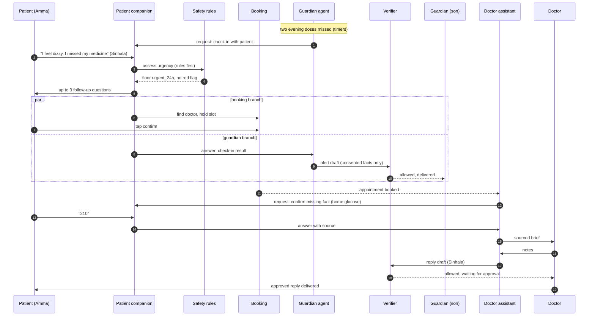

# Workflow

Two workflows: how SuwaPath processes a case, and how the team builds SuwaPath.

## 1. Process flow: one case, end to end

If a red flag fires at any point: booking stops, the patient sees the 1990 card, and the guardian
receives the emergency alert. If the doctor does not answer within 4 hours, the patient is told and
offered another doctor.

### What happens inside the system
1. A person acts in the web app, or a timer fires.
2. The owning module changes state, appends case events, writes outbox events and audit entries in
   one transaction.
3. The worker delivers each event to its subscribers (idempotent, retried, dead-lettered on repeated
   failure).
4. Supervisor subscribers turn events into agent jobs. Agent workers run the agent's LangGraph graph.
5. Agents call tools with their own principal (consent enforced by the module) and talk to each other
   only through typed messages.
6. Every cross-role message passes the verifier before delivery.
7. The browser receives updates through server-sent events.

## 2. Implementation workflow

### Phases
| Phase | Dates | Output |
|---|---|---|
| Plan | 27 Nov | specifications, decisions (ADRs), work breakdown |
| Foundation (Wave 0) | 27 to 28 Nov | contracts, platform, event backbone, gateway with offline mode, schema, module stubs, frontend foundation, CI; verified locally |
| Data prep | from 27 Nov | routing labels, red-flag vignettes, attack set, model cards |
| Modules (Wave 1) | 29 Nov | modules implemented against frozen ports, in parallel |
| Agents (Wave 2) | 29 to 30 Nov | runtime, tools, three agents, baseline, verifier |
| Screens (Wave 3) | 30 Nov | patient, guardian, doctor, hospital, admin screens |
| Integration and evaluation (Wave 4) | 1 Dec | seed world, Amma end to end, CareBench results |
| Delivery | 2 Dec | demo video, final documents, submission |

### Steps for every piece of work
1. Read the spec sections the issue cites. If something is unclear, follow the ambiguity protocol in
   `AGENTS.md`.
2. Take an issue labelled `ready`, assign yourself, branch `feat/<number>-<name>`.
3. Change only the paths in the issue's ownership boundary. Contract changes go first, in their own
   pull request.
4. Write tests at the level the risk tier requires (test-first for critical code).
5. Open a pull request that closes the issue; CI must be green and one teammate approves.
6. Merge to `main`; the `ready` workflow unblocks dependent issues.

### Running the project
See the README for setup. Summary: copy `.env.example` to `.env`, `docker compose up` in `project/`,
open the web app, log in with a demo account. Without model keys everything runs in offline mode,
clearly labelled.
