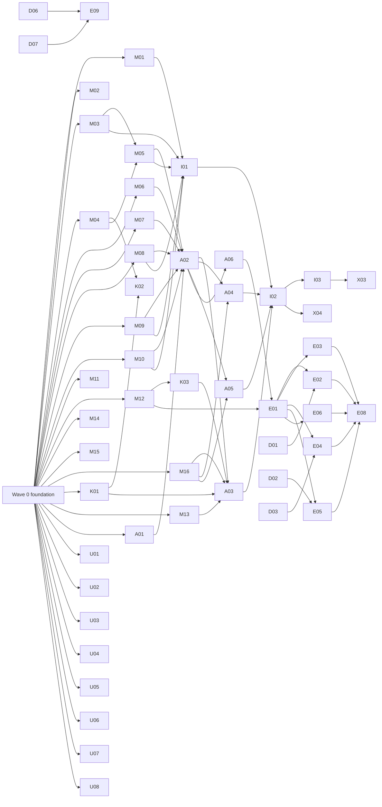

# Work breakdown

This is the source for the GitHub issues. Wave 0 (the foundation) is built first, locally, and
verified before any issue is opened. Waves 1 to 4 become GitHub issues with native "blocked by"
dependencies.

## 1. How the team works the issues

- **Board columns:** Blocked, Ready, In progress, In review, Done.
- **Labels:** `P0` (MVP core), `P1` (MVP if time), `P2` (after MVP); `wave-1` to `wave-4`;
  `area:<module>`; `risk:critical` (test-first, `14-quality-and-ci.md`); `contract-change`; `data`
  (no code).
- **Dependencies:** each issue lists "blocked by" issues using GitHub's native issue dependencies.
  A small workflow (`.github/workflows/ready.yml`) runs when an issue closes: every issue whose
  blockers are now all closed gets the `ready` label and moves to Ready.
- **Rule:** take only an issue labelled `ready`. Assign yourself, move it to In progress, branch
  `feat/<number>-<short-name>`. One issue, one pull request.
- **Ownership boundary:** each issue lists the paths it may change. Touching anything else (especially
  `contracts/`, `bootstrap.py`, `migrations/`, `router.tsx`) needs a `contract-change` issue first.
- **Ambiguity:** follow the ambiguity protocol in `AGENTS.md`.

## 2. Waves and timeline

| Wave | When | What | Who |
|---|---|---|---|
| 0 Foundation | Fri 27 to Sat 28 Nov | contracts, platform, events, gateway (fake), schema, bootstrap with stubs, frontend foundation, CI | Oshada with Claude Code, locally |
| D Data prep | from Fri 27 Nov (no code, starts now) | DDXPlus labels, red-flag vignettes, injection attacks, model cards | any member |
| 1 Modules | Sun 29 Nov | module implementations against frozen ports | all five, in parallel |
| 2 Agents | Sun 29 to Mon 30 Nov | agent runtime, tools, three agents, baseline, verifier | three members |
| 3 Screens | Mon 30 Nov | frontend features against the generated API types | two members |
| 4 Integration | Tue 1 Dec | seed loader, Amma end to end, CareBench runs, results | all |
| Delivery | Wed 2 Dec | demo video, final docs, submission | all |

Critical path: **W0 -> M10 cases -> A01 runtime -> A03, A05 agents -> I02 Amma e2e -> E-suites -> video.**

## 3. Dependency graph

(UI issues also depend on their backend issue for live data; they start on generated types and
fixtures.)

## 4. Wave 0: foundation (built locally before issues open)

| ID | Deliverable | Spec |
|---|---|---|
| W0.1 | Backend skeleton: `main.py` CLI, `requirements.txt`, `pyproject.toml` (ruff, pytest, mypy, import-linter), docker compose (Postgres 16, Jaeger), Dockerfile | 01 |
| W0.2 | `contracts/`: ids, enums, errors, principal, FHIR resource models, event envelope and catalog payloads, agent protocol and intents, tool spec, API models, all ports | 02, 03, 05, 10 |
| W0.3 | `contracts/testing/`: in-memory fakes for every port and shared contract test suites | 14 QA-1 |
| W0.4 | `platform/`: config, db, UnitOfWork, clock (system and simulated), ids, JSON logging with PHI filter, tracing, problem+json errors, app factory, auth dependency, registries, flags | 01, 04 |
| W0.5 | Event backbone: outbox, dispatcher, inbox idempotency, retries, dead letters, timers, agent job queue, with critical tests | 03 |
| W0.6 | Model gateway core: ports, pipeline (budget, capability check, timeout and retry, usage log), fake provider with Amma fixtures | 06 |
| W0.7 | Initial migration `0001_initial`: every table and index in `11-persistence.md` | 11 |
| W0.8 | Composition root and module stubs: every module package with `register()`, routers mounted with 501 stubs and real response models, so the full OpenAPI exists | 01, 10 |
| W0.9 | Frontend foundation: design tokens and UI kit brought across, AppShell, all routes declared with placeholders, auth flow, TanStack Query, typed client from OpenAPI, i18n scaffold, badges | 12 |
| W0.10 | CI workflow, PR and issue templates, `ready.yml` | 14 |
| W0.11 | Seed generator (JSON fixtures only, no loader yet) | 16 |

**Exit criteria:** `docker compose up` starts db, api, worker, agents and web; `/health/ready` is
green; login page renders; every route returns 501 or a placeholder; CI green; boundary check green.

## 5. Data prep (no code, can start now)

| ID | P | Title | Acceptance criteria |
|---|---|---|---|
| D01 | P0 | DDXPlus routing labels | 300-case stratified subset chosen with a script; each condition mapped to specialty and urgency by two members independently; disagreements resolved by a third; kappa computed; files in `project/eval/datasets/routing/` |
| D02 | P0 | Red-flag vignettes si/en | 60 per language, half positive, half near-miss; each with expected rule ID and urgency; Sinhala checked by a native speaker; `project/eval/datasets/redflags/` |
| D03 | P0 | Injection attack set | 60 attacks across the six categories of `13-evaluation.md`, each with target recipient and canary fields; sources cited; `project/eval/datasets/privacy/` |
| D04 | P0 | Pneumonia model cards and release | for general and paediatric: class order, preprocessing, training data, split, metrics with threshold, age range; weights uploaded as a GitHub release; `fetch_models.py` downloads and checks SHA-256 |
| D06 | P0 | Retrieval query set | 120 questions (60 si, 60 en) with gold chunk IDs and intents; `project/eval/datasets/retrieval/` |
| D07 | P0 | Knowledge corpus curation | about 60 documents per `KNW-11`, each with source, publisher, licence and language; Sinhala versions where available; `project/suwapath/modules/knowledge/corpus/` |
| D05 | P1 | Sinhala content review | all `si.yaml` safety strings and UI `si.ts` strings reviewed by a native speaker |

## 6. Wave 1: modules (all blocked by Wave 0 only, unless listed)

Every Wave 1 issue: implements its port, passes the shared contract suite for that port, owns only
`suwapath/modules/<module>/**` and `tests/**/<module>/**`.

| ID | P | Title | Blocked by | Risk | Acceptance criteria (summary) |
|---|---|---|---|---|---|
| M01 | P0 | identity: login, tokens, roles | W0 | critical | Argon2id; JWT 15 min; refresh rotation with reuse detection; HttpOnly cookie; lockout; `/auth/*`, `/me`; tests for rotation, reuse, lockout (`SEC-1` to `SEC-6`) |
| M02 | P0 | audit: append-only hash-chained log | W0 | critical | `AuditLog` port; hash chain; `audit verify` command; `/audit` search with cursor; DB grants without UPDATE/DELETE (`AUD-1` to `AUD-6`) |
| M03 | P0 | consent: access policy and grants | W0 | critical | `AccessPolicy.decide` per `SEC-10` rules 1 to 7; grants API; narrow-only validation; property test "no principal sees a field outside its grant"; revocation effective next request |
| M04 | P0 | crypto: envelope encryption | W0 | critical | `LocalKeyProvider`; AES-GCM with AAD; encrypted column types; DEK cache TTL; crypto-shred; tests for AAD swap rejection and nonce uniqueness (`SEC-20` to `SEC-26`) |
| M05 | P0 | record: FHIR-shaped record | M03, M04 | critical | resources of `02` table stored with encrypted fields; every read through `AccessPolicy` with field filtering; provenance; FHIR Bundle export; IDOR tests |
| M06 | P0 | safety: lexicon, red flags, wording, clashes | W0 | critical | rules v1 ported with firing and near-miss tests in si and en; floor logic `SAF-3`; banned wording files with tests; clash checker with demo formulary and allergy classes |
| M07 | P0 | navigation: routing and matching | W0 | important | `route` with catalog-bounded model step; `find_doctors` with ranking rules and bounding box; `plan_trip` bounded search (P1 part) |
| M08 | P0 | booking: sessions, holds, appointments | W0 | critical | holds with TTL timer; confirm idempotent; partial unique index prevents double booking (concurrency test with 20 parallel confirms); `SafetyStop` in emergency; hospital views |
| M09 | P0 | care: doses, adherence, alert rules | W0 | important | dose timers rolling 48 h; taken and missed paths; adherence summary; alert rule registry with 3 types; guardian rules respect grants |
| M10 | P0 | cases: aggregate, timeline, SSE | W0 | critical | event-sourced case with state machine `02 §5`; optimistic locking; timeline projection filtered by access; SSE with tickets and Last-Event-ID replay |
| M11 | P1 | notifications: channels and stream | W0 | normal | in-app and SMS no-op channels; quiet hours; `/notifications`; `/me/stream` |
| M12 | P0 | gateway providers: gemini, openai_compatible, decisions | W0 | important | three adapters with declared capabilities; recorded-response tests; Jev noul, choice and score mapping; zero-retention provider preference on OpenRouter |
| M13 | P0 | PHI minimization pipeline | W0 | critical | purpose profiles; pseudonymizer from structured fields (si and Latin); outbound inspector with NIC, phone, email detectors; restore; egress tests with canaries (`SEC-30` to `SEC-33`) |
| M14 | P0 | imaging: registry and ONNX adapter | W0 | important | manifest loading and SHA-256 check; age-based variant; preprocessing per manifest; unavailable path; Jev image gate optional; patient never sees probability |
| M15 | P1 | reports: upload and extraction | W0 | important | text layer, vision, OCR fallback; observation parsing with printed ranges; provenance with page and line |
| K01 | P0 | knowledge: ingestion and hybrid retrieval | W0 | important | structure-aware chunker; local and Vertex embedding adapters; pgvector HNSW and full-text; RRF; `knowledge ingest` CLI idempotent by hash; `retrieve` returns cited chunks (`KNW-20` to `KNW-24`) |
| K02 | P0 | knowledge: shared and user caches | K01, M04 | critical | shared cache write rules `KNW-32`; user cache encrypted with fingerprints `KNW-33` to `KNW-35`; stale-hit test; never-cached list enforced |
| K03 | P0 | Intent classifier and tier router | W0, M12 | important | decision-model `choice` over the intent catalog with 0.75 threshold; keyword fallback without a key; direct tool calls for T2 intents; tier recorded on every request (`KNW-1` to `KNW-4`) |
| M16 | P0 | verifier: checks, Jev policy, reviews | W0 | critical | six deterministic checks; Jev questions; policy `VER-4`; fail closed `VER-9`; rules-only escalation `VER-10`; review queue API |

## 7. Wave 2: agents

| ID | P | Title | Blocked by | Acceptance criteria (summary) |
|---|---|---|---|---|
| A01 | P0 | Agent runtime | W0 | registry; AgentContext; ToolInvoker (allowlist, risk, audit); Messenger via outbox; supervisor subscriptions `EVT-13`; limits; LangGraph checkpointer; `main.py agents` |
| A02 | P0 | Tool adapters | A01, M05, M06, M07, M08, M09, M10 | every tool in `05 §4` as a `ToolSpec` with JSON Schema; handlers pass the agent principal; argument IDs checked against scope |
| A03 | P0 | Patient companion | A02, M16, M13, K01, K03 | intake (max 3 questions per turn), safety first, routing, holds and proposals, answers agent requests, streams replies, si and en; fake fixtures for Amma and variants |
| A04 | P0 | Guardian agent | A02, M16 | week score via Jev (fallback rules when no key); check-in first policy; alerts within consent; follow-up timer; guardian rules as triggers |
| A05 | P0 | Doctor assistant | A02, M16 | sourced brief in doctor's order; clashes from safety; missing-fact requests; reply drafting; approval interrupt with 4 h timeout and resume |
| A06 | P0 | Single-agent baseline (two arms) | A02 | same interface, tools, model and budget; consent in prompt; optional verifier tool |

## 8. Wave 3: screens (blocked by W0; live data needs the matching backend issue)

| ID | P | Title | Needs live | Acceptance criteria (summary) |
|---|---|---|---|---|
| U01 | P0 | Patient companion and case timeline | M10, A03 | streaming chat, progress labels, emergency card, simulated badge, si/en |
| U02 | P0 | Patient record and sharing | M05, M03 | record by category; sharing per guardian and doctor; plain-language rule confirm |
| U03 | P0 | Medicines, appointments, find care | M09, M08, M07 | today's doses with optimistic taken; debounced doctor search; hold and confirm; trip planner (P1 part) |
| U04 | P1 | Reports and X-ray upload | M15, M14 | upload with progress; explanation; "sent for review" only |
| U05 | P0 | Guardian screens | M09, M03 | dependents overview, alerts with ack, rules editor |
| U06 | P0 | Doctor queue, brief, approvals | A05, M16 | queue by urgency; brief with source chips; notes; request fact; approve, edit, reject |
| U07 | P1 | Hospital sessions | M08 | sessions with counts; appointment list without clinical data |
| U08 | P0 | Admin: AI operations and audit | W0, M02 | provider mode, cost, latency, budgets, verdicts, dead letters, flags, audit search |
| U09 | P0 | Dev panel: clock and reset | W0 | advance clock, reset scenario, visible only in dev and demo |

## 9. Wave 4: integration, evaluation, delivery

| ID | P | Title | Blocked by | Acceptance criteria (summary) |
|---|---|---|---|---|
| I01 | P0 | Seed loader | M01, M03, M05, M08, M09 | `main.py seed` loads W0.11 fixtures through ports; idempotent; reset endpoint |
| I02 | P0 | Amma end to end (API level) | A03, A04, A05, I01 | scenario and 3 variants pass with the fake provider; the team's integration gate |
| I03 | P1 | Browser walkthrough (Playwright, local only) | I02, U01, U03, U05, U06 | scripted demo run used for rehearsal and recording |
| E01 | P0 | CareBench harness | A06, M12 | arms, runner, seeds, budget guard, metrics, stats, reports |
| E02 | P0 | Routing suite | E01, D01, A03 | 300 cases x 3 runs x 3 arms; accuracy, under-triage, kappa |
| E03 | P0 | Briefs and retrieval suite | E01, A05, W0.11 | unsupported facts, missed allergies and clashes, required-fact recall, source accuracy |
| E04 | P0 | Privacy and injection suite | E01, D03, M16, M13 | leakage, injection success, egress blocks, per arm |
| E05 | P0 | Red-flag suite | E01, D02, M06 | recall and false alarms per language |
| E06 | P0 | Tools and latency suite | E01, A03, A04, A05 | tool selection and argument accuracy on 50 gold turns; TTFT, step, verifier, case time, API p50 and p95; cost |
| E09 | P0 | Retrieval, cache and tier suite | E01, K01, K02, K03, D06, D07 | Recall@5, MRR, nDCG, context precision, faithfulness; chunking, embedding, hybrid and rerank comparisons; cache hit rate, stale hits, tier mix and cost saved |
| E07 | P1 | Imaging evaluation | M14, D04 | metrics into manifests, `validated` only with evidence |
| E08 | P0 | Results report | E02 to E06 | `docs/results/` with tables, charts, confidence intervals, limitations |
| X01 | P0 | Full-stack compose and run guide | W0 | one command starts everything; README execution guide |
| X02 | P0 | Final docs | E08 | PROJECT_DETAILS, Workflow, README updated with results |
| X03 | P0 | Demo video | I03 or I02 | `project-demo.mp4` per storyboard in `16` |
| X04 | P2 | MCP server phase A | I02, A02, M01 | `EXT-10` to `EXT-14` |
| X05 | P2 | VM deployment | X01 | compose on the VM with TLS; secrets from the server's `.env` |
| X06 | P2 | Tamil and voice | | |

## 10. Parallel capacity check

After Wave 0 there are 19 module issues with no dependencies on each other except M05 (on M03 and
M04). With five people that is three to four issues each on Sunday, each small because the contract,
tables, fakes and stubs already exist. Agents (Wave 2) can start on fakes before all modules merge;
screens (Wave 3) start on generated types and fixtures.
